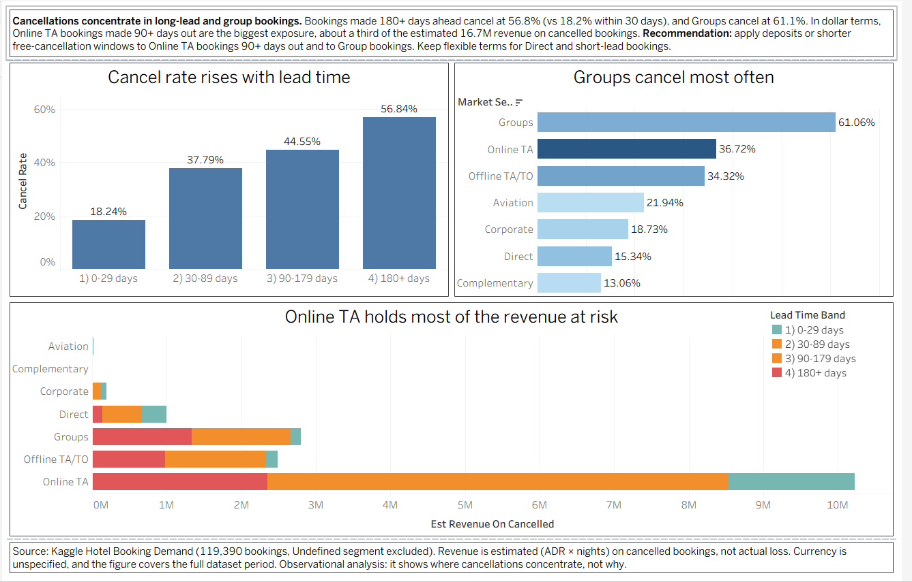

# Hotel Booking Cancellations: Where Do They Concentrate, and What Do They Cost?

**Live dashboard:** [Tableau Public](https://public.tableau.com/app/profile/ankit4553/viz/Tableau_Hotel_ADR/Dashboard1)

## Objective

Which bookings cancel the most, and what does it cost? This project analyses hotel booking cancellations and recommends where cancellation policy should be tightened.

## Data

- Kaggle, [Hotel Booking Demand](https://www.kaggle.com/datasets/jessemostipak/hotel-booking-demand)
- 119,390 bookings from a City Hotel and a Resort Hotel
- Overall cancellation rate: about 37% (about 44,200 cancelled bookings)

## Method

1. Loaded the CSV into SQL Server 2025 Express (database `HotelBookings`, table `dbo.hotel_bookings`).
2. Cleaned types in SQL. For example, `children` contains "NA", so I used `COALESCE(TRY_CAST(children AS int), 0)`.
3. Wrote SQL queries for cancellation rate by market segment, arrival month and lead-time band (0-29, 30-89, 90-179, 180+ days).
4. Checked whether segment and lead time are separate effects by crossing them.
5. Estimated revenue on cancelled bookings as ADR x total nights.
6. Exported a summary table to CSV and built the dashboard in Tableau Public.

SQL is in [`/sql`](sql/). The exported summary table is in [`/data`](data/).

## Key findings

1. **Cancel rate rises steadily with lead time.** Bookings made 180+ days ahead cancel at 56.8%, versus 18.2% for bookings made within 30 days (30-89 days: 37.8%; 90-179 days: 44.6%).
2. **Groups cancel the most, and the effect stacks with lead time.** Groups cancel at 61.1%, the highest of any segment. Lead time matters inside every segment: Groups booked 90+ days ahead cancel at 68.9% (43.9% under 90 days), Online TA at 47.6% (30.3%) and Direct at 21.5% (13.7%). Direct and Corporate are the most reliable, at 15.3% and 18.7%.
3. **Online TA holds most of the revenue at risk.** Online TA accounts for about 10.2M of the estimated 16.7M revenue on cancelled bookings (about 61%). Online TA bookings made 90+ days ahead alone are about 5.5M, roughly a third of the total.

Side findings:
- Arrival month is a weak driver (cancel rate ranges from 30.5% in January to 41.5% in June).
- Families (bookings with children or babies) do not cancel in a consistent direction. The pattern reverses between the City Hotel and the Resort Hotel, so family status is not a clear driver.

## Recommendation

Apply non-refundable deposits or shorter free-cancellation windows to:
1. **Online TA bookings made 90+ days ahead**, for the biggest revenue impact.
2. **Group bookings**, for the highest cancel rate.

Keep flexible terms for Direct and short-lead bookings, which cancel at roughly 14-18%. Test any policy change on a subset before rolling it out.

## Limitations

- Observational analysis: it shows where cancellations concentrate, not why they happen.
- Revenue figures are an estimate (ADR x nights on cancelled bookings), not actual loss. Rooms may be resold and deposits may be kept.
- The dataset states no currency, so figures are in unspecified currency units. They cover the full dataset period (about two years), not a single year.
- The "Undefined" market segment (2 bookings) was excluded from the summary table.

## Tools

SQL Server 2025 Express, SSMS, Tableau Public, GitHub Desktop

## Author

Ankit Sharma | www.linkedin.com/in/ankit-sharma-08025430
